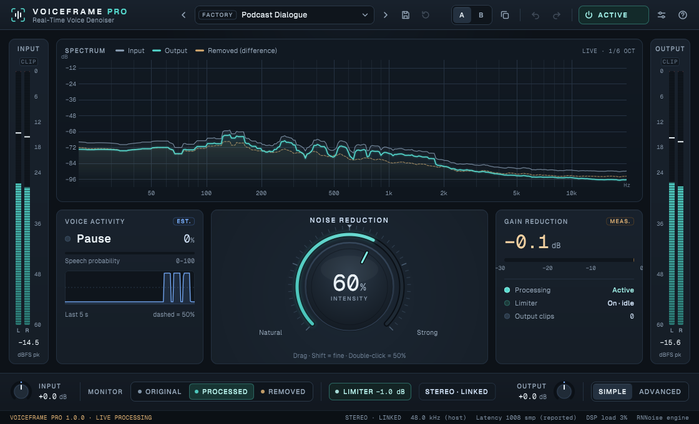
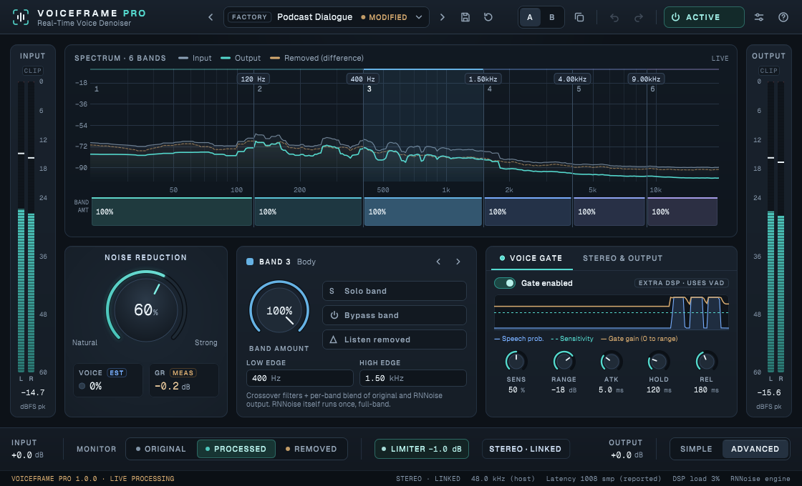
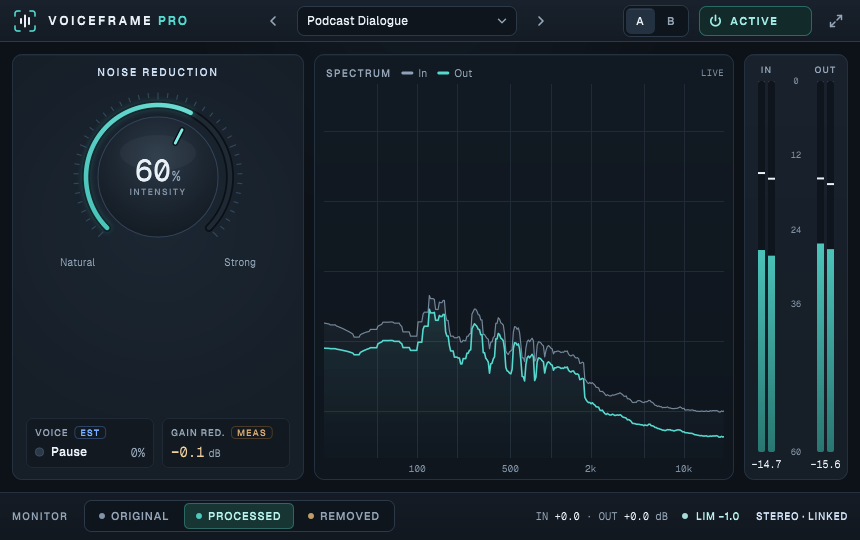

# VoiceFrame Pro

A real-time voice denoiser plugin (VST3) built with [JUCE](https://juce.com) and Xiph.Org's
[RNNoise](https://github.com/xiph/rnnoise) neural network.

One knob sets how strongly the RNNoise result replaces the original signal. Advanced mode adds a
six-band frequency-dependent blend, a voice-activity gate and stereo/output controls.



| Advanced | Compact |
| --- | --- |
|  |  |

## Features

- **RNNoise denoising** at 48 kHz. Other host rates (44.1 – 192 kHz) are resampled internally with a windowed-sinc resampler.
- **Noise Reduction amount** (0–100 %): a blend between the original and the denoised signal. It sets processing intensity, not a measured percentage of noise removed.
- **Six-band blend** with draggable crossovers, a per-band amount, plus band solo, band bypass and band "listen removed". RNNoise itself runs once on the full band.
- **Voice gate** driven by RNNoise's speech-probability estimate, with sensitivity, range, attack, hold and release.
- **Monitoring**:
  - Original, Processed, or Removed (input minus output). If you hear words in Removed, the amount is too high.
- **Stereo**:
  - Linked mode applies one shared gain curve to both channels to keep the image steady; Dual mono processes L and R independently.
  - Stereo width control.
- **Output**: output gain and a safety limiter with an adjustable ceiling.
- **Workflow**:
  - Factory and user presets, with a modified indicator.
  - A/B comparison.
  - Undo / redo.
- **Display**:
  - Live spectrum with 1/6-octave smoothing.
  - Input and output meters, measured gain reduction, speech-probability history.
- **Bypass**: latency-matched, host-automatable. Interface scaling 75–150 %.

Latency is reported to the host: 1,008 samples at 48 kHz. That is one RNNoise frame, plus frame buffering, plus 1 ms of limiter look-ahead.

## Building

Requirements: CMake 3.15+ and a C++17 compiler (Visual Studio 2022+, Xcode or GCC/Clang). On Linux, install JUCE's
[usual dependencies](https://github.com/juce-framework/JUCE/blob/7.0.12/docs/Linux%20Dependencies.md).

```sh
cmake -S . -B build -DCMAKE_BUILD_TYPE=Release
cmake --build build --config Release --parallel
```

CMake uses a local `juce/` checkout if one is present, otherwise it downloads JUCE 7.0.12. The plugin ends up in
`build/VoiceFramePro_artefacts/Release/VST3/VoiceFrame Pro.vst3`. Copy it to your VST3 folder:

| OS | Folder |
| --- | --- |
| Windows | `C:\Program Files\Common Files\VST3` |
| macOS | `~/Library/Audio/Plug-Ins/VST3` |
| Linux | `~/.vst3` |

## Tests

The `VoiceFrameProTests` console app checks:

- Bypass and latency alignment at 44.1, 48, 88.2, 96 and 192 kHz.
- Level transparency at 0 %.
- Noise reduction at 100 %.
- Stability across monitor, band, gate and stereo modes, and the limiter ceiling.
- Presets, A/B, and session state round-trips.

Given a folder argument, it also renders the editor in each mode to PNG:

```sh
build/VoiceFrameProTests_artefacts/Release/VoiceFrameProTests snapshots
```

Configure with `-DVFP_BUILD_TESTS=OFF` to skip it.

## Project layout

| Path | Contents |
| --- | --- |
| `Source/DenoiseEngine.*` | Resampling, RNNoise, crossover blend, voice gate, monitor routing, safety limiter |
| `Source/PluginProcessor.*` | Parameters, signal flow, metering, state |
| `Source/PresetManager.*` | Factory/user presets and A/B slots |
| `Source/Theme.*`, `Widgets.*`, `Displays.*`, `Views.*`, `PluginEditor.*` | The interface |
| `third_party/rnnoise` | RNNoise v0.1.1, vendored with small MSVC and stereo-link additions (see `README.vendored`) |
| `Resources/fonts` | Geist and Geist Mono |
| `tests` | Test runner |

User presets are saved as `.vfpreset` files in `VoiceFrame Audio/VoiceFrame Pro/Presets` inside your user
application-data folder. **Settings › Show user presets folder** opens it.

## License

VoiceFrame Pro is released under the [GNU General Public License v3.0](LICENSE). JUCE 7 is used under its GPLv3 option.

Third-party components:

- **RNNoise:** © Xiph.Org Foundation and contributors, BSD-3-Clause. See `third_party/rnnoise/COPYING`.
- **Geist and Geist Mono:** © Vercel, SIL Open Font License 1.1. See `Resources/fonts/OFL.txt`.
